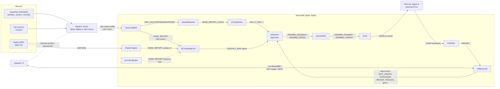

# Architecture

Backend autonomy stack for the SwiftShips USV (Mercury / Morgan Stern drive),
built on [MOOS-IvP](https://oceanai.mit.edu/moos-ivp). Everything runs as MOOS
processes around a single MOOSDB (community `alpha`, port 9000) on the boat
computer. The operator UI talks to the boat only through **iWebSocket**
(ws, port 8000); sensors arrive through a **Signal K** server; actuators are
driven over **J1939 CAN** (`slcan0`).

Related docs:
[CODE_FLOW.md](CODE_FLOW.md) · [APPS.md](APPS.md) · [MISSIONS.md](MISSIONS.md) ·
[UI_PROTOCOL.md](UI_PROTOCOL.md) · [CAN_INTERFACE.md](CAN_INTERFACE.md) ·
[KNOWN_ISSUES.md](KNOWN_ISSUES.md) · [DEVELOPMENT.md](DEVELOPMENT.md)

## System diagram (real boat, `missions/s1_morgan_city_signalk/real.moos`)



## Layers

| Layer | Apps | Notes |
|---|---|---|
| Sensor input | iDivisorNMEA, iRadarTargets, (iSignalK, unused) | All NMEA arrives via Signal K → UDP 10111. Radar arrives directly on UDP 8091. |
| Position glue | pNodeReporter (core), pXYpublisher | iDivisorNMEA only publishes lat/lon; pNodeReporter cross-fills X/Y and pXYpublisher republishes them as `NAV_X/NAV_Y`. |
| Contacts | pContactMgrV20 (core), iDivisorNMEA (AIS), iRadarTargets, pContactSpawn, pSensorFusionTracker_ref (realvision only) | All contacts are `NODE_REPORT`s. |
| Decision | pHelmIvP (core) + `alpha.bhv` + `lib_behaviors-test` (`BHV_Waypoint_mod`) | Flat mode flags: `WAYPOINT`, `STATIONING`, `REGION`, `TRAILING`. See [CODE_FLOW.md](CODE_FLOW.md#helm-modes). |
| Low-level control | planchaPID | Replaces pMarinePID. Heading PID → rudder; feed-forward + PI → thrust. |
| Actuation | iCAN | J1939 steering, gear (ETC2), engine speed (TSC1). |
| Feedback | iCANRec | Engine telemetry (EEC1/2, ET1, ...). Not used in any control loop. |
| Operator | iWebSocket | Only UI channel. 20 Hz JSON out, `KEY=value` commands in. |
| Simulation | uSimMarineV22 (core), iNMEA, pTrafficSim, pColavEval, `tools/aissim` | See [MISSIONS.md](MISSIONS.md). |

## Repository layout

```
CMakeLists.txt        top-level build (finds MOOS + moos-ivp, USE_UTM=ON, builds tools/ then src/)
build.sh / clean.sh   build helpers (out-of-tree in ./build, binaries in ./bin, libs in ./lib)
src/                  MOOS apps + behavior library (see APPS.md)
tools/aissim/         standalone NMEA/AIS vessel simulator (not a MOOS app)
missions/             .moos / .bhv mission files
  s1_morgan_city_signalk/   CURRENT missions (real, simulated, external, realvision, ...)
  s1_morgan_city/           legacy pre-Signal K mission
  alder/, xrelay/           stock moos-ivp-extend examples
data/                 Morgan City chart (morgan_city.tif/.info), test video
scripts/              python/bash bench tools (CAN bridges, NMEA sniffers, VectorNav helpers)
docs/                 this documentation
```

## What is built

`src/CMakeLists.txt` builds: `lib_behaviors-test`, `pXRelayTest`, `iDivisorNMEA`,
`planchaPID`, `iNMEA`, `iSignalK`, `iWebSocket`, `pXYpublisher`, `iCAN`,
`iCANRec`, `pContactSpawn`, `pTrafficSim`, `pColavEval`, `iRadarTargets`,
`pSensorFusionTracker_ref`. Top-level also builds `tools/aissim`.

**Not built** (in tree only): `pVisionDetector_ref` (commented out; needs
OpenVINO), `pVisionDetector`, `pSensorFusionTracker`, `iSensorFusion`
(empty template), `iCANReceiver` (blocking predecessor of iCANRec).

## Key conventions & cross-cutting facts

- **Geodesy origin**: Morgan City, `LatOrigin=29.71970895316288`,
  `LongOrigin=-91.14705165281887`. It is in every `.moos` file **and hardcoded**
  in iWebSocket (7 places), iSignalK, `tools/aissim/aissim.cfg`.
- **Projection**: `USE_UTM=ON` (top-level `CMakeLists.txt`). Must match the
  moos-ivp core build; UTM vs local grid differ by ~100 m at Morgan City.
  iWebSocket's UI→x/y path and iSignalK always use UTM regardless of the flag.
- **Speed units**: on the real boat `NAV_SPEED` is **knots** (raw GPRMC SOG);
  planchaPID's tables are tuned in knots. In simulation (uSimMarineV22)
  `NAV_SPEED` is m/s. AIS/pTrafficSim/pContactSpawn contacts are m/s;
  iRadarTargets / fusion contacts are knots. See [KNOWN_ISSUES.md](KNOWN_ISSUES.md).
- **Rudder units**: planchaPID calls it degrees (±20); iCAN interprets
  `DESIRED_RUDDER` as **percent of steering travel** (±100).
- Comments in older code are in Portuguese (`rumo` = heading, `leme` = rudder,
  `contato` = contact, `DivisorNMEA` = NMEA splitter).
